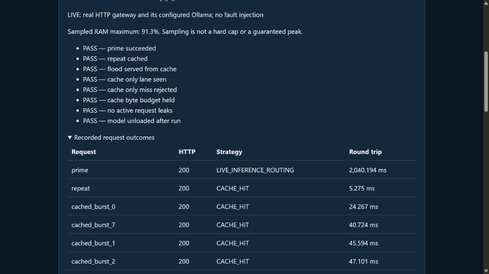

# Project Aegis

Manage local AI requests on a small laptop with exact-request caching, memory-aware admission, bounded concurrency and measured evidence.

**Portfolio work sample — built with substantial Codex assistance.** This repository is a reviewed source/evidence snapshot. It has fresh Git history to avoid carrying over private development metadata. Source publication is not a new app deployment.



## Review the work

- [Purpose, contribution and limitations](ACADEMY-WORK.md)
- [Verification details](ACADEMY-WORK.md)
- [Privacy review](PRIVACY-REVIEW.md)

79 project tests passed. Recorded real inference on 5 November: 2.04 seconds fresh and 5.28 milliseconds cached. Recovery fault tests are simulated.

## Attribution

The applicant directed requirements and requested useful, measurable results. Codex substantially implemented, debugged and executed the recorded checks. No independent authorship, user adoption or guaranteed admissions outcome is claimed. The applicant should describe their own decisions and learning in their own words.

## Setup and original documentation

# Working Aegis laptop demo

Open http://127.0.0.1:8000/aegis or run `run_aegis_laptop.bat` from this existing project. The new profile uses an isolated 105 MB CPU model, 512-token context, immediate model unloading and bounded waiting for memory headroom. The final real CLI benchmark and visible browser proof passed with the RAM guard unchanged. See [AEGIS-LAPTOP-RESULTS.md](AEGIS-LAPTOP-RESULTS.md) for exact results, startup, limitations and application-demo evidence.

The original connection/developer tools below are preserved. Their older result counts are historical; the current full test suite has 79 passing tests. Model quality and sustained-load behavior are not established.

## Portable recorded review

Run `.\.venv\Scripts\python.exe export_aegis_review.py` to create
`results/aegis-review.html`. Open this self-contained file without an API key,
model download or running gateway. It shows source fingerprints, recorded request
timings and separate real-model/simulated sections. It never calls a model.
After starting the updated gateway, `/aegis/review` serves the same report.
The exporter rejects wrong-mode/nonboolean checks, escapes report content, and
does not present a failed check as a pass. See `ACADEMY-WORK.md` for provenance
and current verification. Existing real timings remain dated 5 November 2026.

---

# Connection Clinic

A read-only laptop connectivity troubleshooter: run five checks, understand the evidence, and compare another run after trying a fix. It does not use a chatbot, AI model, or paid API.

## Why use it?

When a laptop says it is connected but an app will not load, a nontechnical user often cannot tell support which part failed. Connection Clinic collects a small, understandable evidence report and shows whether the check outcomes changed after reconnecting or completing a network sign-in. It combines existing networking techniques into a simple workflow; it is not a novel diagnostic algorithm. User demand and usefulness in a real lab still need validation.

## Run on Windows

1. Install Python 3.11 or newer (tested with Python 3.14 on this laptop).
2. Double-click `run_clinic.bat`. The first run installs dependencies and needs internet.
3. Open http://127.0.0.1:8000 . Click **Check my connection**.
4. Read the evidence and suggested next steps. Make any changes yourself, then click **Run again & compare**.
5. Download a JSON report if you want to share the two results with support.

No Ollama, administrator rights, or account is needed for Connection Clinic. Keep the terminal open. Press Ctrl+C to stop. If a server is already running on port 8000, use its page instead of starting another copy. The app stays accessible locally if internet connectivity fails; its probes will report failures or timeouts.

## Checks and interpretation

- Local interface: an up interface has a non-loopback, non-link-local IP. Virtual/VPN interfaces can count; this is not proof of a working physical connection.
- System DNS: resolve example.com through the configured OS resolver.
- Direct IP: try TCP to 1.1.1.1:443 without a DNS lookup. One destination can be blocked independently.
- HTTPS: request example.com with certificate verification and expect HTTP 200.
- Network sign-in: request Microsoft's documented connectivity-test text. Redirects are not followed; changed content only suggests interception, filtering, or a possible portal.

Independent probes run concurrently with a six-second deadline each. Only one diagnostic runs per server process. The app never changes DNS, resets an adapter, disables a firewall, or follows a portal login link. Every result is an observation; advice is conservative. Direct connections may differ from browsers using a proxy or VPN. Unknown local interface information is not treated as a confirmed disconnection.

Microsoft reference: https://learn.microsoft.com/en-us/windows-server/networking/ncsi/ncsi-frequently-asked-questions

## Privacy

The fixed endpoints see normal network metadata when checks run. Reports do not include adapter names, local IP addresses, SSIDs, portal locations, or HTTP bodies. There is no report-upload service. The before/after results live in the browser page's memory and disappear on reload unless downloaded. Server access logs record endpoint requests, not diagnostic response contents. Downloaded reports have UTC timestamps, check outcomes, public test destinations, and advice. Host/origin checks restrict browser access, and the launcher binds to localhost only. Do not expose the server publicly.

## Tests

```powershell
.\.venv\Scripts\python.exe -m unittest discover -s tests -v
.\.venv\Scripts\python.exe -m pip check
```

Optional real browser test:

```powershell
npm install
npx playwright install chromium
npm run test:clinic
```

`results/clinic-live.json`: real network check. `results/clinic-browser.json`: real desktop/mobile-width browser evidence, before/after and export checks. `results/automated-tests.txt`: 22 passing tests (13 for diagnostics, 9 protecting the existing AI experiment). Failure behavior is simulated in automated tests; a real broken network was not created or repaired.

## Architecture

Browser → local FastAPI endpoint → concurrent fixed probes → explicit interpretation rules → evidence + suggested steps → browser comparison and local export.

`network_clinic.py` contains probes, interpretation and the API router. `static/clinic.html` is the UI. `gateway.py` hosts the new landing page and preserves the earlier AI project at `/ai-lab`. `run_clinic.bat` starts the app without needing Ollama. The earlier project documentation is preserved in `AI-LAB.md`.

## Limits and next validation

This is a functional prototype tested on one Windows laptop. A healthy scan does not prove all sites work; a failed destination does not prove the whole network is down. It does not inspect Wi-Fi signal quality, run bandwidth tests, or definitively identify a root cause. Mobile-width checks are not physical phone tests. It has not been deployed, tested in a college lab, or adopted by users. Real user interviews, observed troubleshooting sessions, and multiple network environments are the next validation steps.

Implementation, tests, and documentation were developed with substantial Codex assistance. Application answers should describe the student's actual contribution and understanding accurately. No selection outcome is guaranteed.


## Specific-service checks and lab comparison (v2)

Scroll to **Is a specific service reachable?** Enter an anonymous computer label and a public HTTPS URL. The checker records DNS → TCP → certificate-verified TLS → HTTP HEAD as separate stages. A failed prerequisite causes later stages to be marked skipped, not failed. HTTP status codes are retained: an HTTP 404 means the server responded, not that the connection failed. No redirects, login, body content, query parameters, IP literals, private networks or non-443 ports are supported. HEAD may be treated differently from a browser GET. A redirect or 401/403/405 is a warning, not proof of an outage.

For an actual multi-computer comparison:

1. Run the app on each computer and use the same exact public service URL/path.
2. Choose different anonymous labels, then download a service report on each computer.
3. Transfer the JSON files to one computer and import them under **Compare reports from different computers**.
4. Click Compare. Review timestamps, stage results and HTTP status codes. Download the combined comparison if useful.

A random device ID persists in that browser's local storage; the results themselves stay in page memory. One report per device identity is accepted. Different browser profiles are not proof of different physical computers. Imported reports are validated but not authenticated, and their claims are not independently verified. Reports contain your chosen label and complete service URL/path; avoid sensitive URLs. Import up to 12 files, maximum 64 KiB per file. Comparisons require the exact same normalized URL and reject duplicate reports or device identities.

**Load simulated lab example** provides a clearly labeled three-computer scenario for demonstrations. No actual extra computers were accessed. Clear the list before loading it; imported reports are never silently replaced.

### Public-target safeguards and trust

Every returned DNS address must be public; mixed public/private answers are rejected. Up to three validated numeric addresses are tried, avoiding a second hostname lookup at connection time. TLS keeps the original hostname for verification. Requests do not follow redirects. Certificate checks use the pinned certifi public CA bundle, consistently with existing HTTPX checks, not the Windows certificate store. An organization-only CA or browser proxy may give different results; certificate checks are never disabled.

### Reproduce current checks

```powershell
.\.venv\Scripts\python.exe -m unittest discover -s tests -v
.\.venv\Scripts\python.exe tests/service-live.py
npm run test:services
npm run test:clinic
```

Current suite: 36 passing automated tests. Real GitHub, example.com and PyPI checks passed. A missing example.com page returned HTTP 404 and was correctly reported as an HTTP warning. The browser test validates real service export, JSON imports, duplicate rejection, combined export, simulation labels, table rendering, and mobile-width layout. Only one actual laptop has been tested. Multi-computer behavior was exercised with simulated reports. See SERVICES-RESULTS.md.


## Developer Clinic: browser/API failure evidence

Open http://127.0.0.1:8000/developer . The new workflow adds a real browser failure lab and offline analysis of a HAR capture from your own application. Existing connection, service-check, report-comparison, and AI-lab routes remain available.

### Setup and demo

Install Python 3.11+ and Node.js 20+ (this run used the installed Python 3.14 and Node runtime). Double-click `run_developer.bat` for a fresh setup: install locked Node/Python dependencies and Playwright Chromium, then start the local app. Setup needs internet; the failure lab itself uses owned loopback servers only. If the app is already running, open its developer page instead of launching a duplicate server.

- **Run browser failure lab** runs real Chromium and two HTTP origins through five faults plus one healthy control. Each case is checked in broken and preconfigured corrected variants.
- **Load last measured run** loads the saved experiment without rerunning it.
- Inspect before/after findings, requests, direct API control, and actual screenshots. Download the complete evidence JSON.
- Each case's request details include a link to its original HAR recorded from the owned lab. You can import that HAR with the listed frontend and intended JSON API URLs.

The automated browser runner only visits known owned fixtures. Arbitrary real applications are supported through local HAR import, not unattended remote browser automation. The importer performs no network requests and never saves the raw imported HAR. It reads a bounded payload (1 MiB / 200 entries), drops unrelated origins, and exports only selected sanitized observations. Query strings, URL credentials, fragments, cookies, headers and bodies are omitted, but paths can still contain sensitive information. HAR files usually lack console and JavaScript error evidence; a failed request alone is not classified as confirmed CORS. Header-derived HTTP status/content type and standard browser certificate-error signals support triage, not complete root causes.

### Developer verification

```powershell
.\.venv\Scripts\python.exe -m unittest discover -s tests -v
npm run test:developer
npm run test:clinic
npm run test:services
```

Current automated suite: **50 tests passed**. The live developer browser check verified 12 actual page loads, five expected failure categories, the healthy control, 12 screenshots, evidence download, and import of an actual recorded API-500 HAR through the UI. Desktop and mobile-width checks passed. See DEVELOPER-RESULTS.md and results/developer-lab-latest.json.

### Boundaries

Corrections are supplied experimental variants, not automatic code repair. The lab uses port 8012 temporarily, refuses occupied ports, and cleans up only its own processes. The main app must be on 127.0.0.1:8000. One lab runs at a time with a 60-second worker limit. No production incident, live deployment, login workflow, arbitrary code modification, or real-user usefulness was verified. Reports and screenshots are retained locally; historical captures can consume disk space after repeated runs. No accuracy rate over general applications is claimed.
